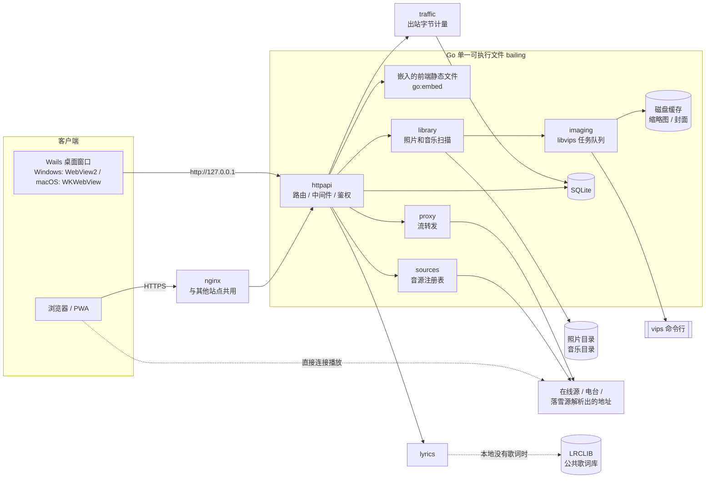
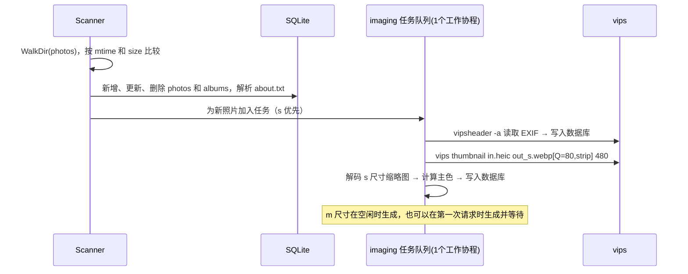
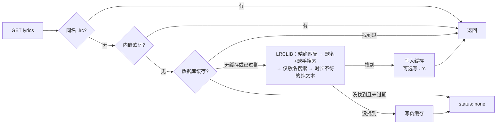

# 架构设计

> 本文描述系统架构、模块划分、数据模型、API、音源插件（含落雪自定义源接口）以及性能策略。
> 标注「（P2）」「（P3）」的内容分别属于第二、第三阶段，第一阶段只预留接口。
> v1.1：部署改为 nginx；新增流量计量（8.4 节）和在线歌词（8.5 节）；前端动画和手势改为原生实现（见第 2 节）。

## 1. 总体架构



**核心思想：**

1. **一个可执行文件**：后端、前端、数据库驱动全部编译在一起（`CGO_ENABLED=0`，即不依赖 C 库），只需要外部安装 libvips。
2. **前后端分离，但一起发布**：前端是纯静态的单页应用（SPA），只通过 HTTP 接口和后端通信。因此前端将来可以原样嵌入 Wails 桌面端。
3. **文件系统就是数据源**：照片和音乐的组织方式由目录决定；SQLite 只存索引、统计、账号等「派生数据」，删掉也能通过重新扫描重建（统计数据除外）。
4. **音源插件化**：本地、直链、电台、落雪都实现同一组 Go 接口，前端用统一的方式搜索、解析、播放。

## 2. 技术选型与理由

| 层 | 选型 | 许可证 | 理由 |
|---|---|---|---|
| 语言（后端） | Go 1.23+ | BSD | 单文件部署、内存低、并发简单、方便交叉编译 |
| HTTP | 标准库 `net/http`（Go 1.22 起支持带方法和参数的路由） | BSD | 不需要框架；`http.ServeContent` 自动处理分段读取和缓存协商 |
| 数据库 | `modernc.org/sqlite` | BSD-3 | 纯 Go 实现，不依赖 C 编译器，交叉编译方便 |
| 音频元数据 | `github.com/dhowden/tag` | BSD-2 | 读取 ID3v1/v2、MP4、FLAC、OGG 的标签、封面和歌词 |
| 图片 | libvips 命令行（`vips` / `vipsthumbnail` / `vipsheader`） | LGPL（作为外部进程调用） | 省内存、速度快，支持 HEIC、WebP，自动按 EXIF 方向旋转 |
| WebP 解码 | `golang.org/x/image/webp` | BSD | 从小缩略图计算主色（纯 Go） |
| 文本编码 | `golang.org/x/text` | BSD | 处理 GBK 编码的 LRC 歌词 |
| 密码 | `golang.org/x/crypto/argon2` | BSD | argon2id 是目前推荐的密码哈希算法 |
| 配置 | `github.com/goccy/go-yaml` | MIT | 读取 YAML 配置 |
| JS 引擎（P3） | `github.com/dop251/goja` + `goja_nodejs/eventloop` | MIT | 运行落雪自定义源脚本（纯 Go 实现） |
| 前端框架 | Svelte 5 + SvelteKit（`adapter-static`，SPA 回退模式） | MIT | 构建时编译、包体积小、自带过渡动画 |
| 构建 | Vite + TypeScript | MIT / Apache-2.0 | |
| 动画 | 原生 Web Animations API + 自写弹簧曲线（`lib/util/motion.ts`） | — | 原计划用 Motion；实际几十行代码就能把弹簧模拟成 CSS `linear()` 曲线，省掉一个依赖 |
| 翻书 | StPageFlip（`page-flip`） | MIT | 双页 / 单页自动切换 |
| 手势 | 原生 Pointer Events（`gallery/Viewer.svelte`） | — | 原计划用 @use-gesture；查看器只需要拖动、双指缩放和旋转、滚轮，原生实现更可控 |
| HLS（P2） | hls.js | Apache-2.0 | 播放 m3u8，按需加载 |
| PWA（P2） | `@vite-pwa/sveltekit` | MIT | 生成 Service Worker 和 manifest |
| 图标 | 内联 SVG（`components/Icon.svelte`，线条风格参考 Lucide） | — | 只有几十个图标，不引入图标库 |
| 字体 | LXGW WenKai（霞鹜文楷）网页字体 | SIL OFL | |
| 反向代理 | nginx（Ubuntu 20.04 自带 1.18）+ certbot | BSD-2 / Apache-2.0 | 和服务器上其他网站统一管理；Let's Encrypt 证书自动续期 |
| 在线歌词 | LRCLIB 公共接口（lrclib.net） | 免费开放，无需密钥 | 本地和内嵌都没有歌词时下载，结果缓存在数据库 |
| 桌面端（P2） | Wails v2（若届时 v3 已正式发布，可评估升级） | MIT | 复用 Go 代码和 Svelte 前端，使用系统自带的网页组件，安装包小 |

## 3. 目录结构

```
web_bailing/
├── cmd/bailing/main.go          # 入口：serve / user / scan / version 子命令
├── internal/
│   ├── app/                     # 组装各模块；Web 端和将来的桌面端共用
│   ├── config/                  # 配置加载、默认值、校验
│   ├── auth/                    # argon2id 密码、会话、登录限速
│   ├── store/                   # SQLite 连接、迁移（migrations/*.sql）
│   ├── library/
│   │   ├── common.go            # 共用工具（ID 生成、GBK/UTF-8 文本解码等）
│   │   ├── photo/               # 相册扫描、about.txt、EXIF、缩略图请求
│   │   └── music/               # 音乐扫描、标签、封面、同名 .lrc、时长
│   ├── imaging/                 # vips 调用、任务队列、主色计算
│   ├── lyrics/                  # LRC 解析、LRCLIB 客户端、查找顺序与缓存
│   ├── stats/                   # 播放 / 查看事件与汇总
│   ├── traffic/                 # 出站流量计量（按天、按类别、按播放会话）
│   ├── sources/                 # 音源接口与注册表
│   │   ├── source.go
│   │   ├── local/               # 本地音乐
│   │   ├── direct/ radio/       # 链接播放、Radio-Browser 电台
│   │   └── lx/                  # 落雪兼容：goja 脚本运行时 + kw/kg/tx/wy/mg 搜索
│   ├── proxy/ netguard/         # 签名转发、出站 SSRF 防护
│   ├── httpapi/                 # 路由、中间件（日志、安全头、计量、鉴权、Origin）、处理函数（含收藏 / 歌单）、SPA
│   └── webui/                   # //go:embed all:dist —— 前端构建产物
│       └── dist/                # npm run build 的输出目录（不提交）
├── web/                         # SvelteKit 前端
│   ├── go.mod                   # 空模块：让 go 命令跳过 web/（node_modules 里偶尔有 .go 文件）
│   ├── src/
│   │   ├── app.html / app.css   # 首帧主题脚本；设计令牌和 5 套配色
│   │   ├── lib/
│   │   │   ├── api/client.ts    # fetch 封装、媒体 URL、类型
│   │   │   ├── stores/          # prefs（主题/语言/EXIF/音量/音效）、session、collections（收藏/歌单）
│   │   │   ├── online/          # 电台、在线搜索、我的（收藏/歌单）、加入歌单按钮
│   │   │   ├── features.svelte.ts / pwa.svelte.ts   # 版本拆分、PWA 注册
│   │   │   ├── i18n/            # zh.ts / en.ts + t()
│   │   │   ├── player/          # 音频引擎、播放条、队列、黑胶、歌词、流量标记、音效（均衡器/频谱/定时/速度）
│   │   │   ├── gallery/         # 书脊封面、相簿（StPageFlip）、查看器
│   │   │   ├── components/      # 顶栏、背景、统计便签、流量提示条、图标
│   │   │   └── util/            # 格式化、弹簧动画
│   │   ├── routes/              # +layout、主页、login、albums、music、settings
│   │   └── service-worker.ts    # PWA：只缓存应用外壳
│   ├── scripts/gen-manifest.mjs # 按版本生成 manifest.webmanifest
│   └── static/icons/            # all / photos / music 三套图标
├── desktop/                     # Wails v2 桌面端（独立 Go 模块 bailing/desktop）
├── deploy/
│   ├── bailing.service          # systemd
│   └── nginx/
│       ├── bailing.conf         # 独立（子）域名
│       └── bailing-subpath.conf # 挂在已有站点的 /bailing/ 下
├── scripts/build.ps1            # Windows 下等价于 Makefile
├── .vscode/                     # 调试配置（Go + Chrome）
├── docs/
├── config.example.yaml          # 生产配置模板
├── config.dev.example.yaml      # 开发配置模板
├── Makefile
└── go.mod
```

> 说明：Go 的 `//go:embed` 只能引用所在目录及其子目录中的文件，所以前端构建输出直接写到 `internal/webui/dist/`（见 `web/svelte.config.js`）。

## 4. 配置文件（config.example.yaml）

```yaml
server:
  listen: "127.0.0.1:8080"        # 由 nginx 反向代理过来；桌面端会使用随机端口
  base_path: ""                   # 挂在子路径时填 "/bailing"（前端构建也要带 BASE_PATH）
  base_url: "https://music.example.com"
  trusted_proxies: ["127.0.0.1"]  # 只信任这些地址传来的 X-Forwarded-For（用于登录限速判断真实 IP）

paths:
  photos: "/srv/bailing/photos"   # 每个子目录 = 一个相册；可写列表 ["/a", "/b"]
  music:  "/srv/bailing/music"    # 同上，多个目录合并成一个曲库
  data:   "/var/lib/bailing"      # 存放 bailing.db、cache/、lx-scripts/

auth:
  mode: "password"                # password | none（none 只允许在监听本机地址时使用）
  session_days: 30
  login_rate: { max_failures: 5, window: "10m", lock: "15m" }

scan:
  on_start: true
  interval: "6h"                  # 定时增量扫描；设为 0 表示关闭
  photo_exts: [jpg, jpeg, png, webp, heic, heif, gif]
  music_exts: [mp3, m4a, aac, flac, ogg, opus, wav]

imaging:
  vips_bin_dir: ""                # 留空表示从 PATH 中查找
  workers: 1                      # 1 核机器只开 1 个
  nice: 10                        # 降低处理图片的进程优先级
  sizes: { s: 480, m: 2048 }      # 长边像素
  quality: 80

lyrics:
  online: true                    # 本地没有歌词时从 LRCLIB 下载
  negative_ttl: "168h"            # 没找到的歌 7 天内不再查询
  save_beside_music: true

traffic:
  monthly_quota_gb: 0             # 0 = 不设额度
  warn_percent: 80
  reset_day: 1
  block_proxy_over_quota: true    # P2

sources:
  proxy:
    enabled: true
    max_concurrent: 4               # 同时转发的音频流（HLS 分片请求不计）
    link_ttl: "24h"                 # 签名转发链接的有效期
    allow_private: false            # 允许访问内网地址；公网服务器保持 false（防 SSRF）
  radio:
    enabled: true
    api_base: "https://de1.api.radio-browser.info"
  lx:
    enabled: true
    scripts_dir: ""               # 默认是 <data>/lx-scripts
    platforms: [kw, kg, tx, wy]   # 有搜索适配器的平台
    request_timeout: "15s"
    cache_ttl: "10m"              # 解析出的播放地址缓存时长
```

## 5. 数据模型（SQLite）

**ID 策略**：照片、相册、歌曲的 ID = `base32(sha1(相对路径))` 的前 12 位。这样重新扫描后 ID 不变，统计数据可以保留；但文件改名会被视为一个新的文件。

```sql
-- 账号与会话
users(id INTEGER PK, name TEXT UNIQUE, display_name TEXT, pw_hash TEXT,
      is_admin INTEGER, created_at INTEGER)
sessions(token_hash TEXT PK, user_id INTEGER, kind TEXT /*cookie|token*/,
         created_at INTEGER, expires_at INTEGER, user_agent TEXT)
prefs(user_id INTEGER PK, json TEXT)  -- 主题、配色、语言、EXIF 开关、音量等

-- 相册
albums(id TEXT PK, dir TEXT UNIQUE, title TEXT, description TEXT, date_text TEXT,
       cover_photo_id TEXT, photo_count INTEGER, color TEXT, mtime INTEGER)
photos(id TEXT PK, album_id TEXT, rel_path TEXT UNIQUE, size INTEGER, mtime INTEGER,
       width INTEGER, height INTEGER, taken_at INTEGER, color TEXT,
       exif_json TEXT, sort_key TEXT, cache_ver INTEGER)

-- 音乐
tracks(id TEXT PK, rel_path TEXT UNIQUE, folder TEXT, title TEXT, artist TEXT,
       album TEXT, album_artist TEXT, track_no INTEGER, disc_no INTEGER, year INTEGER,
       genre TEXT, duration_ms INTEGER, format TEXT, size INTEGER, mtime INTEGER,
       cover_key TEXT, color TEXT, lrc_path TEXT, has_embedded_lyrics INTEGER,
       name_guessed INTEGER /*004：歌名/歌手来自文件名而非标签*/)

-- 多目录（library.Roots）：rel_path / dir 是相对所属根目录的路径。
-- 第一个根目录不加前缀（升级前的 id 不变）；其他根目录加 "@<sha1(绝对路径) 前 4 字节 hex>/"，
-- 所以调整列表顺序不影响 id，改路径则相当于新目录。根目录缺失（未挂载）时跳过，不删除它的行。
-- tracks.folder：第一个根目录下是子目录路径（顶层为 "."），其他根目录是 "<根目录名>/<子目录>"。
-- albums.dir：子目录相簿为 "<前缀><子目录名>"；直接放在根目录里的照片组成的相簿为 "."（第一个根目录）或 "@<key>"（其他根目录），标题默认是根目录名。

-- 统计
play_events(id INTEGER PK, user_id INTEGER, source TEXT /*local|direct|radio|lx:kw...*/,
            ref TEXT, title TEXT, artist TEXT, cover TEXT, listened_ms INTEGER, at INTEGER)
view_events(id INTEGER PK, user_id INTEGER, kind TEXT /*album|photo*/, ref TEXT, at INTEGER)

-- 歌词缓存（LRCLIB 下载结果，含「没找到」的负缓存）
lyrics_cache(track_id TEXT PK, status TEXT, source TEXT, ...)

-- 流量
traffic_daily(day TEXT, category TEXT /*photo|cover|track|proxy|app*/, bytes INTEGER,
              requests INTEGER, PRIMARY KEY(day, category))
stream_sessions(sid TEXT PK, user_id INTEGER, category TEXT, ref TEXT, title TEXT,
                bytes INTEGER, started_at INTEGER, last_at INTEGER)

-- P2（migrations/003_collections.sql，2026-10-16）：收藏与歌单，按用户保存，跨设备同步
favorites(user_id INTEGER, kind TEXT /*track|station*/, source TEXT, ref TEXT,
          data TEXT /*歌曲或电台快照 JSON*/, created_at INTEGER,
          PRIMARY KEY(user_id, source, ref))
playlists(id INTEGER PK, user_id INTEGER, name TEXT, created_at INTEGER, updated_at INTEGER)
playlist_items(playlist_id INTEGER, pos INTEGER, source TEXT, ref TEXT, data TEXT,
               PRIMARY KEY(playlist_id, pos))

-- P3（migrations/002_lx.sql）：脚本元数据来自 .js 文件头注释，数据库只记录启用状态
lx_scripts(id TEXT PK /*sha1(文件名) 前 12 位*/, file TEXT, enabled INTEGER, updated_at INTEGER)
```

- 「最常播放」：对 `play_events` 按 `ref` 分组计数（数据量小，不需要预先汇总）。
- 在线歌曲没有本地 ID，收藏和歌单用 `data` 保存重新播放所需的信息（JSON 快照：source、id、标题、歌手、封面、extra；本地歌曲另存 color、format、folder）。服务器只检查 `source` 和 `id`，单条最大 32KB；每人最多 5000 个收藏、200 个歌单，每个歌单最多 2000 首。
- 数据库启用 WAL 模式（读写可以同时进行）；只开一个写连接，避免并发写冲突。

## 6. HTTP 接口

除标注「公开」的接口外，**都需要登录**（Cookie `bl_session` 或请求头 `Authorization: Bearer <token>`）。

### 6.1 认证与偏好

| 方法 | 路径 | 说明 |
|---|---|---|
| POST | `/api/auth/login` | 公开。`{name, password, remember}` → 设置 Cookie；桌面端可以加 `?token=1` 改为返回令牌 |
| POST | `/api/auth/logout` | 退出登录 |
| GET | `/api/auth/me` | 公开。返回当前用户（未登录时为 `null`）和 `features: {photos, music}` |
| GET / PUT | `/api/me/prefs` | 读取 / 保存个人偏好 |

### 6.2 主页

| 方法 | 路径 | 说明 |
|---|---|---|
| GET | `/api/home` | 公开。访客只返回 `user: null`；登录后加上 `counts`（相册、照片、歌曲数）和 `traffic`（额度提醒） |
| GET | `/api/stats/summary?limit=5` | 最近播放、最常播放、最近看过、最常看过 |
| POST | `/api/stats/play` | `{source, ref, title, artist, cover, listened_ms}` |
| POST | `/api/stats/view` | `{kind, ref}` |

### 6.3 相册

| 方法 | 路径 | 说明 |
|---|---|---|
| GET | `/api/albums` | 书架数据：id、title、date、color、cover、count |
| GET | `/api/albums/{id}` | 相册详情和照片列表（id、宽、高、主色、拍摄时间） |
| GET | `/api/photos/{id}/exif` | 精简后的 EXIF；GPS 信息只有在用户偏好允许时才返回 |
| GET | `/media/photo/{id}/{size}` | `size` 为 `s` / `m` / `o`。HEIC 的 `o` 返回全分辨率 WebP |

### 6.4 音乐

| 方法 | 路径 | 说明 |
|---|---|---|
| GET | `/api/music/tracks?q=&folder=&artist=&album=&sort=&offset=&limit=` | 歌曲列表。`folder` / `artist` / `album` **出现即过滤**，空值表示「未知歌手 / 未知专辑 / 根目录」那一组；不出现才表示不过滤 |
| GET | `/api/music/groups/{folders|artists|albums}` | 浏览维度：`[{name, count, cover}]` |
| GET | `/api/music/tracks/{id}/lyrics` | `{status:"ok|none|instrumental", source:"lrc|embedded|lrclib", synced, lines:[{t, text, trans?}]}` |
| DELETE | `/api/music/tracks/{id}/lyrics` | 清除下载的歌词缓存，下次重新查找（「歌词不对？」） |
| POST | `/api/music/tracks/{id}/duration` | `{ms}`：浏览器测得的时长回填（有些文件标签里没有时长） |
| GET | `/media/track/{id}?sid=&dl=1` | 音频流，支持分段读取；`sid` 把同一次播放的所有分段请求归到同一个流量计数；`dl=1` 加 `Content-Disposition: attachment`（文件名「歌手 - 歌名.ext」，UTF-8 用 `filename*`） |
| GET | `/media/cover/{key}?size=s|m` | 封面 |
| GET | `/media/rcover?u=` | 在线封面转发（浏览器直连图床失败时由前端 `coverFallback` 改用）。只允许 kuwo.cn、kugou.com、gtimg.cn、qq.com、126.net、163.com、migu.cn 的 http(s) 地址；要求 200 + `image/*`、≤ 3MB；`Cache-Control: private, max-age=604800`；计入「封面」流量 |

### 6.5 音源（P2 / P3，已实现）

| 方法 | 路径 | 说明 |
|---|---|---|
| GET | `/api/sources` | 已注册的音源及能力：`local`、`direct`、`radio`、`lx:kw` …；落雪平台只有在有脚本支持时才带 `resolve` 能力和 `qualities` |
| GET | `/api/sources/{id}/search?q=&page=` | 搜索（`radio`、`lx:*`、`local`） |
| POST | `/api/play/resolve` | `{source, track: TrackRef, quality}` → `{url, format, mode, proxy_url, cors, expires_at}` |
| GET | `/api/radio/stations?q=&country=&tag=&lang=&page=` | 电台搜索（服务器缓存 10 分钟） |
| GET | `/api/radio/countries` | 地区列表（缓存 1 天） |
| GET | `/api/lyrics/lookup?title=&artist=&album=&duration_ms=` | 在线歌曲的歌词（LRCLIB，内存缓存 6 小时） |
| GET | `/proxy/stream?d=…&s=…&sid=…&dl=1&name=` | 签名转发：`d` 是 base64 编码的目标（URL、请求头、过期时间、类型），`s` 是 HMAC-SHA256 签名，`sid` 关联流量计数。`dl=1`（仅音频类型、上游 2xx）时以附件下载，文件名取 `name`，扩展名按 Content-Type / URL 推断。落雪歌曲的下载就走这里：浏览器对跨域地址会忽略 `download` 属性，只能经本站转发 |
| GET | `/api/lx/scripts` | 落雪脚本列表、状态、声明的平台和音质、脚本目录 |
| POST | `/api/lx/scripts` | 上传 `{file, content}`（仅管理员） |
| PUT / DELETE | `/api/lx/scripts/{id}` | 启用、停用 `{enabled}` / 删除（仅管理员） |
| POST | `/api/lx/reload` | 重新扫描脚本目录（仅管理员） |

`/api/play/resolve` 的请求可以带 `need_cors: true`（前端开启了均衡器或频谱时）：服务器对普通音频也探测 CORS，结果放在 `cors` 字段。`/api/radio/stations` 支持 `https=1`，只返回 https 地址的电台（Radio-Browser 的 `is_https`）。

### 6.5.1 收藏与歌单（2026-10-16）

| 方法 | 路径 | 说明 |
|---|---|---|
| GET | `/api/favorites?kind=track|station` | `{items:[{kind, item, at}]}`，新的在前 |
| POST | `/api/favorites` | `{kind, item}` 收藏一个；`{kind, items:[…]}` 批量导入（重复的只更新快照） |
| POST | `/api/favorites/remove` | `{source, id}` |
| GET | `/api/playlists` | `{playlists:[{id, name, count, first, updated_at}]}`，`first` 用作封面 |
| POST | `/api/playlists` | `{name, items?}` 新建 |
| GET | `/api/playlists/{id}` | `{id, name, updated_at, items:[…]}` |
| PUT | `/api/playlists/{id}` | `{name?}` 重命名；`{items?}` 整体替换（删除、排序） |
| POST | `/api/playlists/{id}/items` | `{items}` 追加，已经在歌单里的跳过，返回 `{added, skipped}` |
| DELETE | `/api/playlists/{id}` | 删除歌单 |

只能访问自己的歌单，别人的歌单一律返回 404。这些接口属于音乐部分，`features.music=false` 时不注册。

### 6.6 流量

| 方法 | 路径 | 说明 |
|---|---|---|
| GET | `/api/traffic/summary` | 今天、本计费月、按类别、近 30 天、额度、最近经过服务器的播放 |
| GET | `/api/traffic/streams/{sid}` | 当前播放会话的实时字节数（播放条每 4 秒轮询一次） |

### 6.7 管理

| 方法 | 路径 | 说明 |
|---|---|---|
| POST | `/api/admin/rescan?what=photos|music|all` | 手动触发增量扫描 |
| GET | `/api/admin/status` | 扫描进度、缩略图队列长度、版本号 |

| GET | `/api/admin/storage` | 管理员：配置文件路径、相册 / 音乐目录（`{path, exists}` 列表）、数据目录、数据库大小、`cache/photo` 与 `cache/cover` 的大小和文件数 |
| POST | `/api/admin/cache/clean` | 管理员：删除没有照片 / 歌曲引用的缓存文件（按文件名前缀的 id / 封面 key 对照数据库），返回 `{files, bytes}`；扫描进行中返回 409 |

媒体目录**只能**在配置文件里改：网页能指定服务器目录，等于让登录用户读服务器上任意文件夹，风险远大于 SSH 改一个文件。

### 6.8 静态文件与缓存策略

- `/_app/immutable/*`（文件名带内容哈希）：`Cache-Control: public, max-age=31536000, immutable`，即永久缓存。
- `/media/photo/*`、`/media/cover/*`：`private, max-age=2592000` + ETag。因为需要登录才能访问，所以标记为 `private`，只允许浏览器自己缓存。
- `service-worker.js`、`manifest.webmanifest`：`no-cache`，保证已安装的 PWA 能及时拿到新版本。
- 其他路径找不到文件时都返回 `index.html`，由前端路由处理（SPA 回退）。

## 7. 音源插件架构（含落雪接口）

### 7.1 Go 接口

```go
package sources

type Capability string

const (
    CapSearch  Capability = "search"
    CapResolve Capability = "resolve"
    CapLyrics  Capability = "lyrics"
    CapCover   Capability = "cover"
)

type Info struct {
    ID           string       // "local" | "direct" | "radio" | "lx:kw" ...
    Name         string
    Kind         string       // local | online | radio | lx
    Capabilities []Capability
    Qualities    []string     // 例如 ["128k","320k","flac"]
}

// TrackRef 是跨音源统一的歌曲引用；Extra 保存音源私有字段（如落雪需要的 songmid、hash）。
type TrackRef struct {
    Source   string            `json:"source"`
    ID       string            `json:"id"`
    Title    string            `json:"title"`
    Artist   string            `json:"artist"`
    Album    string            `json:"album"`
    Duration int               `json:"duration_ms"`
    Cover    string            `json:"cover"`
    Extra    map[string]any    `json:"extra,omitempty"`
}

// Playable 是解析后的可播放地址。
type Playable struct {
    URL       string            `json:"url"`
    Format    string            `json:"format"`     // mp3 | flac | aac | hls | ...
    Headers   map[string]string `json:"-"`          // 需要额外的请求头时只能由服务器转发
    ExpiresAt time.Time         `json:"expires_at"`
    Mode      string            `json:"mode"`       // direct | proxy（由服务器判断后给出建议）
}

type Source interface{ Info() Info }
type Searcher interface {
    Search(ctx context.Context, q string, page int) ([]TrackRef, bool /*hasMore*/, error)
}
type Resolver interface {
    Resolve(ctx context.Context, t TrackRef, quality string) (*Playable, error)
}
type LyricsProvider interface {
    Lyrics(ctx context.Context, t TrackRef) (*Lyrics, error)
}
```

- 注册表 `Registry` 在启动时注册各个音源；HTTP 层通过类型断言判断某个音源支持哪些能力。
- **第一阶段**：只实现 `local`，但前端播放器已经按 `TrackRef` 加 `Playable` 的方式工作，所以本地和在线歌曲可以放在同一个播放队列里。

### 7.2 直连还是转发的判断（P2，已实现）

判断分两步：服务器先给出建议，浏览器再结合自身情况做最终决定。

**服务器端**（`POST /api/play/resolve`）：

- 返回原始地址 `url`，以及一个签名转发地址 `proxy_url`（转发功能开启时才有）。
- 需要自定义请求头时，`mode` 为 `proxy`。
- 对于 HLS，会带上请求头 `Origin` 探测对方是否允许跨域，结果放在 `cors` 字段，按域名缓存 1 小时。

**浏览器端**（`player.svelte.ts`）：

| 条件 | 方式 |
|---|---|
| `mode=proxy` | 转发 |
| 页面是 https，而地址是 http（混合内容） | 先把地址改成 https **直连**；出错或 9 秒内仍没有可播放的数据，再改用 `proxy_url` |
| HLS，`cors=false`，且浏览器不支持原生 HLS | 转发 |
| 已接入 Web Audio（均衡器 / 频谱），且 `cors=false` | 转发（否则浏览器会输出静音） |
| 其他情况 | 直连；`error` 事件或 hls.js 报致命错误时，自动改用 `proxy_url` **再试一次** |

**为什么电台会产生转发流量**：Radio-Browser 只是目录，音频来自各电台自己的服务器，默认由浏览器直连。产生转发的主要原因是混合内容：网站是 https，而大量老电台只有 http 地址，浏览器会拦截。上表的「先试 https」解决了其中一部分；电台列表的「只看 https 电台」可以从源头避开。

转发时，界面上显示 ⇄ 提示，流量芯片会闪烁。用户可以在设置里关闭自动转发（`prefs.autoRelay`）。

**`/proxy/stream` 的处理：**

- 校验签名和有效期；超出月额度时拒绝。
- 每个音频流占用一个并发名额（`max_concurrent`）。
- 透传 `Range` 请求头，以便拖动进度条。
- HLS 播放列表会被改写：其中的每个 URI（分片、子播放列表、`EXT-X-KEY` 和 `EXT-X-MAP` 的 URI）都换成新的签名转发地址，并带上同一个 `sid`。
- 一边读一边写回浏览器，并逐块刷新输出。
- 所有字节都由流量中间件计入 `proxy` 类别、当前播放会话（sid）和本页面累计。

**出站请求的安全**（`internal/netguard`）：

- 在建立连接时检查**解析后的 IP**，每次重定向都会重新检查。
- 拒绝以下地址：本机、内网、链路本地、CGNAT（含阿里云元数据地址 100.100.100.200）以及各类保留地址。
- 兼容老式 SHOUTcast 电台返回的 `ICY 200 OK` 状态行。

### 7.3 落雪音乐自定义源兼容（P3）

**落雪的两段式模型**（实现时以落雪官方仓库 `lyswhut/lx-music-desktop` 的文档和源码为准，下面的说明需要核对）：

1. **搜索**由落雪**内置的各平台搜索功能**完成。平台代号：`kw` 酷我、`kg` 酷狗、`tx` QQ、`wy` 网易、`mg` 咪咕。搜索结果里带有各平台私有的字段，例如 `songmid`、`hash`、`copyrightId`。
2. **自定义源脚本**只负责「把一首歌解析成可以播放的地址」：
   - 脚本运行在一个沙箱里，通过全局对象 `globalThis.lx` 与宿主程序交互；
   - 脚本初始化时调用 `lx.send('inited', { sources: { kw: { name, type:'music', actions:['musicUrl'], qualitys:['128k','320k','flac'] }, … } })` 声明自己支持哪些平台和音质；
   - 宿主程序触发 `request` 事件 `{ source, action:'musicUrl', info:{ type: quality, musicInfo } }`，脚本返回一个 Promise，结果是 URL 字符串；
   - 脚本可以用的工具：`lx.request(url, options, callback)`（发起 HTTP 请求）、`lx.utils.crypto`（md5、aes、rsa、随机字节）、`lx.utils.buffer`、`lx.utils.zlib`、`lx.version`、`lx.env`、`lx.currentScriptInfo`。
   - 脚本文件开头有一段注释，写有 `@name`、`@description`、`@version`、`@author`、`@homepage`。

**所以要做到「放入落雪源脚本就能用」，需要两部分**：

```
internal/sources/lx/
├── platforms/            # ① 搜索：移植落雪内置的各平台搜索代码（Apache-2.0 许可，保留署名）
│   ├── kw.go  kg.go  tx.go  wy.go  mg.go
│   └── musicinfo.go      # 把搜索结果转换成落雪的 musicInfo 结构，放进 TrackRef.Extra
├── runtime/              # ② 解析：goja 沙箱运行脚本
│   ├── vm.go             # 每个脚本一个虚拟机 + 事件循环（支持 Promise、setTimeout）
│   ├── lxapi.go          # 实现 lx.request / send / on / utils / EVENT_NAMES
│   └── header.go         # 解析脚本开头的注释
├── manager.go            # 扫描 scripts_dir，热加载、启用 / 停用，状态写入 lx_scripts 表
└── source.go             # 对每个平台注册一个 "lx:<平台>" 音源：
                          #   Search 调用 platforms，Resolve 交给声明支持该平台的已启用脚本
```

**运行时安全约束：**

- 沙箱里**没有**文件系统、进程、`require`；只提供 `lx` 对象和定时器。
- 每次请求有超时（默认 15 秒），超时后中断虚拟机（goja 的 `Interrupt`）。
- `lx.request` 只允许 http/https 协议，禁止访问内网地址（127.0.0.0/8、10.0.0.0/8、172.16.0.0/12、192.168.0.0/16、169.254.0.0/16），防止服务器被脚本利用去访问内部服务（SSRF）。
- 解析出的地址缓存到它的有效期（默认 10 分钟）。
- 只有管理员可以上传或启用脚本。

**实际实现（2026-10-15）**：

```
internal/sources/lx/
├── prelude.js         # 沙箱里先运行：构建 lx 对象、Buffer、定时器、fetch、console；与 Go 之间只用字符串（二进制转成 hex）
├── runtime.go         # 每个脚本一个 goja 虚拟机 + 事件循环 goroutine；单次同步执行超过 5 秒（启动时 15 秒）就中断
├── hostfns.go         # md5、AES（ECB/CBC，PKCS#7 填充）、RSA（无填充）、zlib、lx.request 的 HTTP 实现、脚本头注释解析
├── manager.go         # 扫描目录（每 30 秒检查一次，文件变化即热加载）、启用 / 停用 / 删除、按脚本名依次解析、URL 缓存
├── platforms.go       # 搜索适配器接口；把搜索结果转换成落雪的 musicInfo（songmid、hash、strMediaMid、types、_types …）
├── platform_impl.go   # kw / kg / tx / wy / mg 的搜索
└── source.go          # 为每个平台注册一个 "lx:<平台>" 音源；能力随已加载脚本的声明动态变化
```

解析请求发给脚本的格式与落雪桌面版相同：`{source, action:'musicUrl', info:{type: 音质, musicInfo}}`。脚本没有声明你要的音质时，自动改用它支持的、不高于该音质的最好的一个。

**链接探测（2026-10-21）**：脚本返回 URL 后，服务器先用 `Range: bytes=0-1` 请求一次（6 秒超时）。返回 HTTP ≥ 400 或 `text/html` 时判定为「dead link」，记日志并改问下一个已启用的脚本；全部失败时 `/api/play/resolve` 返回 502，前端看到错误信息里的 `dead link` 就显示「音源脚本给的播放链接打不开」。网络错误不算失败（浏览器直连也许能通）。原因：脚本自己的后端停了以后，脚本照样能加载、照样返回链接，以前浏览器只能显示「这首歌暂时放不了」。

依赖：`github.com/dop251/goja`（MIT 许可，纯 Go 实现，不需要 cgo）。

**咪咕（mg）搜索（2026-10-16 补上）**：咪咕的搜索接口 `jadeite.migu.cn/music_search/v3/search/searchAll` 要求请求头带 `sign = md5(关键词 + 固定盐值 + deviceId + 毫秒时间戳)`，同时带 `timestamp`、`deviceId`、`uiVersion`、`channel`（与落雪桌面版相同）。这是它比其他平台晚做的原因。结果转换为落雪 musicInfo：`songmid = songId`、`copyrightId`、`PQ/HQ/SQ/ZQ24 → 128k/320k/flac/flac24bit`、`lrcUrl/mrcUrl/trcUrl`。

**使用方式：** 把 `.js` 源脚本放进 `<data>/lx-scripts/`，或者在「设置 → 落雪音源脚本」上传，然后在音乐页「在线 → 落雪音源」选择平台、搜索、选择音质并播放。详见 `usage.md` 第 7 节。

## 8. 关键流程

### 8.1 照片扫描与缩略图



- 缓存路径：`<data>/cache/photo/<id前2位>/<id>_<尺寸>_<缓存版本>.webp`
- 请求的尺寸还没生成时：**插队生成并等待**（最多 10 秒）；超时则对可直接显示的格式先返回原图，HEIC 返回 503 让前端稍后重试。
- vips 进程以 `nice -n 10` 运行，并把 `VIPS_CONCURRENCY` 设为 1，避免把突发性能实例的 CPU 积分一次耗光。

### 8.2 播放本地歌曲

1. 前端调用 `GET /api/music/tracks` 得到 `TrackRef` 列表，加入播放队列。
2. 对本地歌曲，播放器直接把 `/media/track/{id}` 交给 `<audio>` 标签；浏览器会自动发出分段请求，由 `http.ServeContent` 处理。
3. 播放超过 30 秒或 50% 后调用 `POST /api/stats/play`。
4. 通过 Media Session API 设置标题、封面和上一首 / 下一首等操作，让手机锁屏界面可以控制播放。

### 8.3 鉴权

- 会话令牌 = 32 字节随机数；数据库里只保存它的 SHA-256 哈希，即使数据库泄露也拿不到可用的令牌。
- Cookie 设置为：`HttpOnly; SameSite=Lax; Path=<base_path>/`；`base_url` 是 https 时再加 `Secure`。
- 所有写操作（POST / PUT / DELETE）都检查 `Origin`：必须等于 `base_url`、在 `allowed_origins` 里，或与请求的主机相同，防止跨站请求伪造（CSRF）。
- 登录限速按 IP 和用户名分别计数。

### 8.4 流量计量（服务器按流量计费）

```
请求 → logAndRecover → securityHeaders → meter → attachUser → checkOrigin → 路由
                                           │
                                           └─ countingWriter：每次 Write 都把字节数记到
                                              「今天 × 类别」，以及（如果有）当前播放会话
```

- **类别**由路径决定：`/media/photo` 照片、`/media/cover` 封面、`/media/track` 本地音乐、`/proxy` 转发（P2），其余为 `app`。
- **播放会话**：前端每次开始播放时生成随机 `sid`，拼在音频地址上（`/media/track/{id}?sid=`）。拖动进度条产生的多次 Range 请求都累加到同一个会话；会话只属于发起它的用户。
- 计数先在内存里累加，每 30 秒批量写入 SQLite（`traffic_daily`、`stream_sessions`），退出时再写一次；按天的数据保留 400 天，会话保留 90 天。
- 前端：`TrafficChip` 显示「方式 · 已播放时长 · 已传输大小」；`direct` 不轮询也不计数；`proxy`（P2）用强调色并闪烁提醒；`TrafficBanner` 在超过 `warn_percent` 时出现。
- nginx 对 `/media/`、`/proxy/` 必须关闭 `proxy_buffering`，否则 nginx 会预读整个文件，计数会偏大。

### 8.5 歌词获取



- 请求 LRCLIB 时带 `User-Agent: bailing/<版本>`（该项目要求客户端标识自己），默认超时 8 秒。
- 匹配时参考时长，避免同名不同版本；优先使用带时间轴的歌词，其次纯文本；标记为纯音乐时返回 `instrumental`。
- 「歌名 + 歌手」搜不到时只按歌名再搜一次（歌手写法不同，如繁简体），仍要求时长相差 ≤ 5 秒。
- 歌名、歌手完全一致但时长相差 > 5 秒（剪辑版 / 现场版）时，只取纯文本（`Approx`），去掉时间轴，不写 `.lrc`，以免以后一直用这份对不上时间的歌词。
- 没有标签的本地文件，歌名和歌手由文件名推断：`music.nameOrder` 读同目录有标签的文件，对比文件名和标签投票决定「歌名 - 歌手」还是「歌手 - 歌名」；同目录无依据时用整个曲库（`name_guessed = 0` 的行）投票；仍无依据时按「歌手 - 歌名」。迁移 004 把所有 `mtime` 置 0 以触发一次全量重新索引，并清掉旧的负缓存。
- LRC 解析在服务器端完成（`internal/lyrics/lrc.go`）：多时间戳、`[offset:]`、同一时间戳的第二行作为翻译。

## 9. 前端架构要点

| 模块 | 说明 |
|---|---|
| `api/client.ts` | 统一的 `fetch` 封装。`apiBase` 默认是空字符串（同源）；桌面端会注入本地地址。收到 401 时跳转到登录页 |
| `player/player.svelte.ts` | 播放器状态：队列、当前歌曲、播放模式、进度、音量、流量会话。只有一个 `<audio>` 元素，挂在根布局上，所以切换页面不会中断播放；队列和进度保存在 localStorage，刷新后可以继续（不会自动播放） |
| `player/Lyrics.svelte` | 二分查找当前行并平滑滚动；用户手动滚动后 3 秒内不自动跟随 |
| `gallery/Book.svelte` | 封装 StPageFlip；根据 `matchMedia` 判断宽屏双页 / 窄屏单页；只渲染当前页前后 ±6 页的图片 |
| `gallery/Viewer.svelte` | 自研查看器：用一个变换状态 `{x, y, scale, angle}` 组合成一条 CSS `transform`；Pointer Events 处理单指拖动、双指缩放和旋转、Shift 或手柄旋转；角度限制在 ±180°，接近 0°/90°/180° 时吸附 |
| `app.css` + `app.html` | 设计令牌和 5 套配色 × 深浅色都在 `app.css`；`app.html` 里的小脚本在首帧前设置主题，避免闪烁 |
| `routes/+layout.svelte` | 背景、顶栏、流量提示条、播放条、`<audio>`；页面切换用 View Transitions 淡入淡出 |
| `i18n/` | `zh.ts` / `en.ts`；`t(key, params)` 读取响应式的 `prefs.lang`，切换语言即时生效 |

| `stores/collections.svelte.ts` | 收藏与歌单（服务器保存）；登录后加载，并把旧的浏览器本地电台收藏上传一次 |
| `player/fx.svelte.ts` | Web Audio 图：10 段 BiquadFilter 均衡器 + AnalyserNode；第一次打开均衡器或频谱时才创建，之后无法拆除（Web Audio 的限制） |
| `player/FxPanel.svelte`、`Spectrum.svelte` | 播放速度、定时停止、均衡器面板；唱片下方的频谱 |
| `features.svelte.ts` | 构建版本（`VITE_BAILING_APP`）和服务器 `features` 取交集，决定显示相册 / 音乐 |
| `service-worker.ts`、`pwa.svelte.ts` | PWA：只缓存应用外壳（JS、CSS、字体、图标、页面），`/api`、`/media`、`/proxy` 一律不经缓存；新版本安装后由用户点「刷新」切换 |

**播放器新增（2026-10-16）**：

- **播放速度**：`playbackRate` + `preservesPitch`，直播固定 1×；
- **定时停止**：到点前 8 秒用 requestAnimationFrame 渐弱音量，然后暂停并恢复音量；「放完这首」在 `ended` 时不再切到下一首；
- **均衡器 / 频谱**：一旦接入 `createMediaElementSource`，跨域且没有 CORS 的音频会变成静音。因此接入后，`<audio>` 带上 `crossorigin`（本服务器的地址用 `use-credentials`，外部地址用 `anonymous`），resolve 请求带 `need_cors`，对方不允许跨域时改走转发。

## 9.1 拆分发布：相册版 / 音乐版

| 层 | 开关 | 作用 |
|---|---|---|
| 构建 | `VITE_BAILING_APP=all|photos|music`（`make web APP=…`） | 导航、首页入口、页面守卫；`scripts/gen-manifest.mjs` 生成对应的 PWA 名称、图标、启动页 |
| 服务器 | `features.photos` / `features.music` | 不注册另一部分的接口，不扫描对应目录，不启动电台和落雪源；`/api/auth/me` 把开关告诉前端 |
| 桌面端 | `-ldflags "-X main.edition=…"` | 窗口标题、配置目录、固定端口、默认 `features` |

## 9.2 桌面端（Wails v2，`desktop/`）

- 单独的 Go 模块（`desktop/go.mod`，模块名 `bailing/desktop`，用 `replace bailing => ../`），服务器的构建完全不依赖 Wails 和 cgo；
- 启动时在 `127.0.0.1:固定端口`（完整版 47821、相册版 47822、音乐版 47823）运行完整的 bailing 服务，`auth.mode: none`；
- Wails 的资源处理器只返回一个跳转页，窗口随后加载这个本地地址。这样音频的分段读取、Cookie、流式传输都和浏览器完全一致（Wails 的自定义协议对音视频流的支持不稳定）；
- 固定端口让页面的「源」每次启动都相同，主题、播放队列等本地存储得以保留；端口被占用时退回随机端口（会在日志里提示）；
- `desktop.yaml` 的 `remote_url` 可以让窗口直接打开远程服务器；
- macOS 的 `build/darwin/Info.plist` 设置了 `NSAllowsLocalNetworking`，允许窗口访问 http://127.0.0.1。

## 10. 性能与资源预算（1 核 1G，Ubuntu 20.04）

| 项 | 预算 / 策略 |
|---|---|
| 内存 | 系统约 200MB + nginx 约 10MB + bailing 30–80MB + vips 峰值 100–200MB。**建议开 1G swap**；systemd 限制 `MemoryMax=400M` |
| CPU | 缩略图串行生成 + `nice`；扫描是增量的；没有转码 |
| 带宽 | 书架和相簿用 s 尺寸（约 30KB）；查看器用 m 尺寸（约 300KB）；放大超过 100% 时才加载 o 尺寸；音频 `preload="none"`；在线音源默认直连；所有出站字节都计量 |
| 前端 | 首屏 JS（gzip 后）< 80KB；StPageFlip 和 hls.js 按需加载；中文字体按需分片加载 |
| 数据库 | WAL 模式 + 合理的索引；统计查询加 `LIMIT` |

## 11. 安全清单

- [ ] 只能通过 HTTPS 访问（nginx + certbot）；bailing 只监听 127.0.0.1；只信任 `trusted_proxies` 传来的 `X-Real-IP`
- [ ] 媒体接口全部需要登录；路径参数都用 ID，**绝不把文件路径直接拼接到请求里**，防止目录穿越
- [ ] 密码使用 argon2id 哈希；登录限速
- [ ] 写操作校验 Origin
- [x] 转发地址带签名和有效期；禁止访问内网地址
- [x] 落雪脚本运行在沙箱里，有超时，只有管理员能管理
- [ ] 响应头：`Content-Security-Policy`、`X-Content-Type-Options`、`Referrer-Policy`
- [ ] EXIF 中的 GPS 默认不返回


